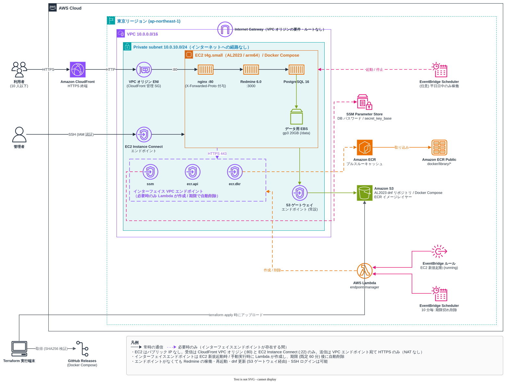

# redmine-terraform

Redmine を AWS に構築する Terraform です。利用者 10 人以下・低コスト運用を前提にしています。

## 構成



> 構成図は draw.io 形式 (`docs/architecture.drawio.svg`) です。
> [draw.io](https://app.diagrams.net/) や VS Code の Draw.io Integration 拡張機能でそのまま開いて編集できます。

```
インターネット
   │  HTTPS (*.cloudfront.net もしくは独自ドメイン)
   ▼
CloudFront
   │  HTTP (CloudFront VPC オリジン / AWS 内部ネットワーク)
   ▼
┌──────────────────────── VPC ────────────────────────┐
│  Private Subnet (インターネットへの経路なし)          │
│   EC2 (t4g.small / Amazon Linux 2023)                │
│    └ docker compose                                  │
│        nginx :80 → Redmine :3000 → PostgreSQL        │
│    └ データ用 EBS (/data: DB・添付ファイル)          │
│        │ アウトバウンドは VPC エンドポイントのみ     │
│        ├ S3 ゲートウェイ   … dnf / Docker Compose    │
│        ├ ecr.api / ecr.dkr … Docker イメージ  ※     │
│        └ ssm               … Parameter Store  ※     │
│                                                      │
│   EC2 Instance Connect エンドポイント ← 管理者の SSH │
└──────────────────────────────────────────────────────┘
 ※ インターフェイスエンドポイントは必要なときだけ Lambda が自動作成・自動削除

EventBridge (EC2 新規起動)  ──▶ Lambda ──▶ エンドポイント作成 (期限タグ付き)
EventBridge Scheduler (10分毎) ─▶ Lambda ──▶ 期限切れエンドポイントを削除
```

| 項目 | 採用 | 理由 |
| --- | --- | --- |
| CloudFront → EC2 接続 | **CloudFront VPC オリジン** | ALB 不要 (約 $20/月 削減)。EC2 にパブリック IP・公開ポート不要 |
| 外向き通信 | **VPC エンドポイントのみ (NAT なし)** | インターネットへの経路を持たず、AWS サービスとだけ通信する |
| インターフェイスエンドポイント | **Lambda で必要なときだけ作成し、期限で自動削除** | 常設すると 3 個で約 $31/月。初回構築・作り直し・バージョンアップ時だけ使う |
| Docker イメージ | **ECR プルスルーキャッシュ (上流: ECR Public)** | Docker Hub 公式イメージのミラー (`public.ecr.aws/docker/library/*`) を自アカウントの ECR 経由で取得。認証情報不要 |
| Docker Compose | **S3 に配置** | `apply` 実行端末で GitHub から取得・SHA256 検証し、S3 にアップロード |
| DB | **EC2 上の PostgreSQL (Docker)** | RDS (最小でも約 $15〜/月) を省略 |
| CPU アーキテクチャ | **Graviton (arm64)** | 同性能の x86 より約 20% 安い |
| 管理アクセス | **EC2 Instance Connect エンドポイント** | 無料。踏み台・パブリック IP 不要。SSH 鍵は接続時に一時的に送り込むため管理不要 |
| シークレット | **SSM Parameter Store (SecureString)** | 標準パラメータは無料 |
| TLS | **CloudFront のデフォルト証明書 / ACM** | 証明書は無料 |

### EC2 への直接アクセスの遮断

- EC2 はプライベートサブネットに配置し、パブリック IP は付与しません (インターネットから到達不可)。
- EC2 のセキュリティグループは、CloudFront VPC オリジン作成時に CloudFront が自動作成する
  セキュリティグループ `CloudFront-VPCOrigins-Service-SG` からの 80 番のみ許可します。
  VPC 内の他リソースからも直接アクセスできません。
- SSH (22 番) は EC2 Instance Connect エンドポイントのセキュリティグループからのみ許可します。
  エンドポイントの利用には IAM 認証 (`ec2-instance-connect:OpenTunnel`) が必要です。
- EC2 のアウトバウンドは VPC エンドポイント宛ての HTTPS (443) のみ許可しています。

## 概算コスト (東京リージョン / 月額)

| リソース | 金額 (USD) |
| --- | --- |
| EC2 t4g.small (24h 稼働) | 約 15.8 |
| EBS gp3 30GB (root 10 + data 20) | 約 2.9 |
| インターフェイス VPC エンドポイント × 3 (作成している間だけ課金: 1 時間あたり約 $0.04) | 約 0〜0.2 |
| S3 ゲートウェイエンドポイント / EC2 Instance Connect エンドポイント | 0 |
| Lambda / EventBridge / CloudWatch Logs (無料枠内) | 約 0 |
| ECR (キャッシュしたイメージ約 1GB) / S3 (Docker Compose) | 約 0.1 |
| CloudFront (無料枠: 1TB 転送 / 1,000 万リクエスト) | 約 0 |
| **合計** | **約 19** |

- `enable_schedule = true` (平日 8:00〜21:00 のみ稼働) にすると EC2 分が約 6 割減り、**約 $9/月** 程度になります。
- 24 時間稼働させる場合は Compute Savings Plans (1 年) でさらに約 3 割削減できます。

## 前提

- Terraform >= 1.6
- AWS 認証情報 (AdministratorAccess 相当)
- `bash` / `curl` / `sha256sum` (または `shasum`) — `apply` 時に Docker Compose を GitHub から取得するため
- (EC2 にログインする場合) AWS CLI v2

## デプロイ

```bash
cp terraform.tfvars.example terraform.tfvars   # 必要に応じて編集
terraform init
terraform apply
```

CloudFront VPC オリジンの作成に 10〜15 分程度かかります。
`apply` 完了後、EC2 の初期化に 10 分程度かかります
(起動を検知した Lambda がエンドポイントを作成 → 利用可能になるのを待って Docker イメージ取得・DB 初期化)。
エンドポイントは `endpoint_ttl_minutes` (既定 60 分) 経過後に自動で削除されます。

```bash
terraform output redmine_url
```

### 初期設定 (必須)

1. `redmine_url` にアクセスし、`admin` / `admin` でログインしてパスワードを変更
2. 「管理」→「設定」→「全般」で以下を設定 (通知メール内のリンクに使われます)
   - ホスト名とパス: CloudFront のドメイン名 (または独自ドメイン)
   - プロトコル: `HTTPS`
3. 「管理」→「設定」→「認証」で「認証が必要」を ON にする (外部公開する場合は強く推奨)

## 運用

### サーバーへのログイン

```bash
$(terraform output -raw ssh_command)
sudo -i
cd /opt/redmine
docker compose ps
docker compose logs -f redmine
```

初期化ログは `/var/log/redmine-setup.log`、エンドポイント管理 Lambda のログは
CloudWatch Logs の `/aws/lambda/<project>-endpoint-manager` にあります。

ログインする IAM ユーザー / ロールには `ec2-instance-connect:OpenTunnel` と
`ec2-instance-connect:SendSSHPublicKey` の権限が必要です。

### インターフェイスエンドポイントの作成 / 削除

| タイミング | 作成 | 削除 |
| --- | --- | --- |
| 初回構築 / EC2 の作り直し | 自動 (EC2 の新規起動を EventBridge が検知) | 自動 (期限切れ後、10 分以内) |
| バージョンアップなどの作業 | 手動 (下記コマンド) | 自動 (期限切れ後) または手動 |
| EC2 の停止 → 起動 (日次スケジュール等) | 作成しない | — |
| `terraform destroy` | — | 自動 (Lambda が全削除してから VPC を削除) |

```bash
# 作成 (ttl_minutes 経過後に自動削除。作成済みなら期限を延長)
$(terraform output -raw endpoint_create_command)
# 状態確認
$(terraform output -raw endpoint_status_command)
# 作業が早く終わったら手動で削除
$(terraform output -raw endpoint_delete_command)
```

エンドポイントがない間も、Redmine の稼働・再起動・dnf のセキュリティ更新 (S3 ゲートウェイ経由)・
EC2 Instance Connect でのログインはすべて利用できます。

### Redmine のバージョンアップ

1. エンドポイントを作成し、`status` で 3 つとも `available` になるまで待つ (2〜5 分)
2. `/opt/redmine/compose.yml` のイメージタグ (例: `.../docker/library/redmine:6.0` → `:6.1`) を変更して、以下を実行

```bash
cd /opt/redmine
docker compose pull && docker compose up -d
```

イメージは ECR プルスルーキャッシュ経由で取得されます (インターネット接続は不要)。
(`user_data` の変更はインスタンス再作成を避けるため無視する設定にしています)

### プラグイン

`/data/redmine/plugins` に配置し、`docker compose restart redmine` を実行します。
EC2 はインターネットに出られないため、プラグインは手元でダウンロードして `scp` 等で転送してください。
追加の gem が必要なプラグインは、そのままではインストールできません (カスタムイメージを ECR に push する等の対応が必要です)。

### データの保持

DB と添付ファイルはデータ用 EBS (`/data`) に保存しており、EC2 を再作成してもデータは残ります。
バックアップは取得しないため、必要に応じて手動で EBS スナップショットを取得してください。

データボリュームには `prevent_destroy` を設定しているため、`terraform destroy` では削除されません。
完全に削除する場合は `ec2.tf` の `prevent_destroy` を外してから実行してください。

## 追加で検討をおすすめする事項

| 提案 | 内容 | 本リポジトリでの対応 |
| --- | --- | --- |
| **独自ドメイン** | `redmine.example.com` 等でアクセス | `custom_domain` / `acm_certificate_arn` / `route53_zone_id` で対応 |
| **夜間・休日停止** | 利用時間外の EC2 停止でコスト削減 | `enable_schedule` で対応 (EventBridge Scheduler) |
| **OS セキュリティ更新** | 日次で `dnf upgrade --security` | 対応済み |
| **メール通知** | チケット更新通知を送る場合は Amazon SES の SMTP を利用 (月 3,000 通まで実質無料)。`/opt/redmine` に `configuration.yml` をマウントして設定 | 未対応 (要望があれば追加可能) |
| **AWS WAF** | ボット・攻撃対策。約 $6〜/月 の追加費用 | 未対応 |
| **監視・通知** | EC2 ステータスチェック失敗時の自動復旧・通知 (CloudWatch アラーム / SNS) | 未対応 (t4g は既定で簡易自動復旧あり) |
| **予算アラート** | AWS Budgets で月額上限を超えたら通知 | 未対応 |
| **tfstate の保管** | 複数人で運用する場合は S3 バックエンドを利用 | `versions.tf` にサンプルあり |
| **SSO 連携** | Google / Microsoft アカウントでログイン (Redmine プラグイン) | 未対応 |

## ファイル構成

| ファイル | 内容 |
| --- | --- |
| `network.tf` | VPC / サブネット / S3 ゲートウェイエンドポイント / EC2 Instance Connect エンドポイント |
| `endpoints.tf` | インターフェイスエンドポイントを自動作成・削除する Lambda / EventBridge |
| `artifacts.tf` | ECR プルスルーキャッシュ / Docker Compose 配置用 S3 バケット |
| `ec2.tf` | Redmine EC2 / データ用 EBS / セキュリティグループ / シークレット |
| `iam.tf` | EC2 用 IAM ロール |
| `cloudfront.tf` | CloudFront ディストリビューション / VPC オリジン |
| `scheduler.tf` | 稼働スケジュール (任意) |
| `templates/` | EC2 の user_data |
| `scripts/` | Docker Compose 取得スクリプト (`apply` 時に実行) |
| `lambda/` | エンドポイント管理 Lambda のコード |
| `docs/architecture.drawio.svg` | 構成図 (draw.io) |
